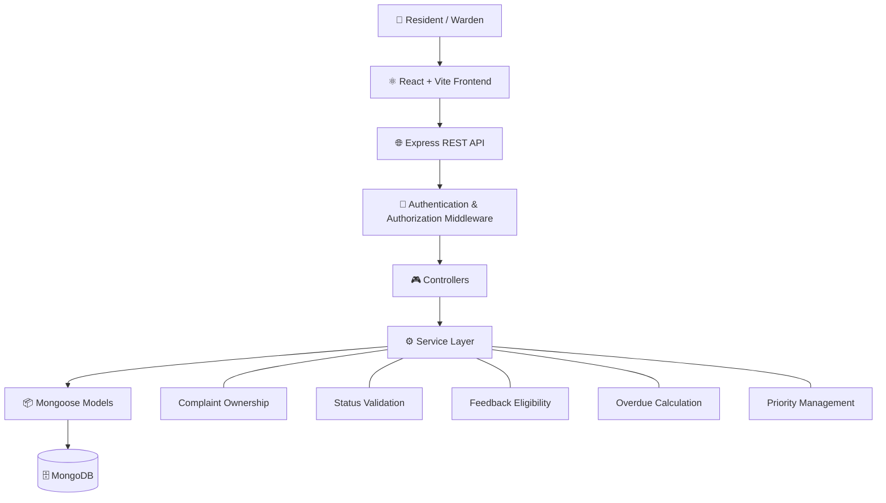

# 🏠 DormFix — Hostel Complaint & Maintenance Management System

<p align="center">
  <strong>A centralized platform for smarter hostel maintenance management.</strong>
  <br />
  Report complaints, track progress, and help wardens manage maintenance efficiently.
</p>


---

## 📌 About the Project

**DormFix** is a web-based Hostel Complaint & Maintenance Management System developed as part of the **Software Engineering and Project Management (SEPM), Section D** course.

Traditional hostel maintenance complaints are often reported verbally, through messaging applications, or using written notes. Such methods make it difficult to track complaints, maintain records, identify overdue issues, and prioritize maintenance work.

DormFix provides a centralized platform where residents can report maintenance problems and monitor their progress, while wardens can manage complaints, prioritize tasks, and track overall maintenance activity.

## 🎯 Objectives

- 📝 Provide a simple and reliable complaint submission system.
- 🔍 Allow residents to track complaint status and history.
- 🧑‍💼 Provide wardens with a centralized complaint management dashboard.
- 🔄 Maintain a structured complaint lifecycle.
- ⏰ Identify unresolved complaints exceeding the **48-hour overdue threshold**.
- 📊 Display complaint statistics and daily resolution trends.
- ⚡ Allow wardens to manually prioritize complaints.
- ⭐ Collect resident feedback after complaint resolution.
- 🔐 Enforce authentication, authorization, and complaint ownership.
- 🛠️ Maintain a modular and extensible software architecture.

## ✨ Key Features

### 👨‍🎓 Resident Dashboard

- 🔑 Resident registration and login.
- 📊 Dashboard displaying complaint statistics and history.
- 📝 Submit maintenance complaints with descriptions.
- 📸 Attach images to complaints.
- 🔎 View complaint details and track progress.
- 🔔 Monitor complaint status through the dashboard.
- ⭐ Submit a rating from **1 to 5** with an optional comment after resolution.
- 🚫 Prevent duplicate feedback submissions for the same complaint.

### 🧑‍💼 Warden Dashboard

- 🔐 Secure warden login through a seeded account.
- 📊 View aggregated complaint statistics.
- 📈 Monitor daily complaint-resolution trends.
- 📋 View and manage complaints submitted by residents.
- 🔍 Filter complaints by status, overdue status, and room.
- ↕️ Sort complaints using supported criteria.
- 🎯 Manually reorder complaints to control their priority.
- 🔄 Update complaint statuses through permitted transitions.
- ⏰ Identify unresolved complaints that exceed 48 hours.

### 🛡️ Security & Data Integrity

- 🔒 JWT-based authentication.
- 🔑 Password hashing using `bcryptjs`.
- 👥 Role-based access control for Residents and Wardens.
- 🔐 Backend protection for restricted API endpoints.
- 👤 Server-side verification of complaint ownership.
- ✅ Server-side validation of complaint data.
- 🔄 Controlled complaint status transitions.
- ⏳ Server-side overdue calculation.
- 🚫 Prevention of duplicate feedback.
- 📁 Validation of uploaded image types and sizes.

## 🔄 Complaint Lifecycle

Every complaint follows a controlled workflow:

```text
📝 SUBMITTED
      |
      v
⚙️ UNDER_PROGRESS
      |
      v
✅ RESOLVED
```

The backend validates status transitions and rejects invalid changes.

A complaint is considered overdue when it remains unresolved beyond the **48-hour threshold**. The overdue status is calculated on the server rather than trusted from the frontend.

## 🛠️ Technology Stack

| Layer | Technologies |
|---|---|
| 🎨 Frontend | React, Vite |
| 🧭 Routing | React Router |
| 🌐 HTTP Client | Axios |
| ⚙️ Backend | Node.js, Express.js |
| 🗄️ Database | MongoDB |
| 📦 ODM | Mongoose |
| 🔐 Authentication | JSON Web Tokens (JWT) |
| 🔑 Password Hashing | bcryptjs |
| 📸 File Uploads | Multer |
| 🔗 API Architecture | REST API |

## 🏗️ System Architecture

DormFix follows a **three-tier client-server architecture** with a layered backend.



### 🧩 Architectural Layers

- **Frontend:** Provides the user interface for residents and wardens.
- **Routes:** Define the backend API endpoints.
- **Middleware:** Handles authentication and authorization checks.
- **Controllers:** Process HTTP requests and responses.
- **Service Layer:** Enforces business rules and complaint-management logic.
- **Models:** Define schemas and perform database operations through Mongoose.
- **Database:** Stores user accounts, complaints, feedback, and counter information.

Separating business logic from HTTP request handling improves maintainability, modularity, and testability.

## 🗄️ Database Design

DormFix uses MongoDB for persistent storage, with Mongoose providing schema definition and validation.

| Collection | Purpose |
|---|---|
| 👥 `Users` | Stores resident and warden account information, roles, credentials, and room details. |
| 📝 `Complaints` | Stores complaint descriptions, resident references, image information, status, timestamps, and priority order. |
| ⭐ `Feedback` | Stores complaint references, resident references, ratings, comments, and submission timestamps. |
| 🔢 `Counters` | Maintains sequence information for sequential identifiers where applicable. |

## 🔐 Security & Business Rules

DormFix enforces important business rules on the backend to maintain security and consistency.

- **Authentication:** Protected resources require valid authentication.
- **Authorization:** Access to restricted operations depends on the user's role.
- **Complaint ownership:** Residents cannot access complaints belonging to other residents.
- **Identity verification:** Resident identity is derived from the authenticated user context.
- **Status validation:** Invalid complaint status transitions are rejected.
- **Overdue calculation:** The server calculates overdue status using the 48-hour threshold.
- **Feedback eligibility:** Feedback can be submitted only for resolved complaints.
- **Duplicate prevention:** Each complaint can receive feedback only once.
- **Image validation:** Uploaded complaint images are checked for permitted type and size.


## 🚀 Getting Started

Follow these steps to set up DormFix locally.

### 📋 Prerequisites

Ensure the following are installed:

- [Node.js](https://nodejs.org/)
- npm
- [MongoDB](https://www.mongodb.com/)
- [Git](https://git-scm.com/)

### 1️⃣ Clone the Repository

```bash
git clone <YOUR_REPOSITORY_URL>
cd <YOUR_REPOSITORY_FOLDER>
```

Replace the placeholders with your actual GitHub repository URL and project folder name.

### 2️⃣ Set Up the Backend

Navigate to the backend directory:

```bash
cd <BACKEND_DIRECTORY>
npm install
```

Configure the backend environment variables required by your application, including the MongoDB connection URI and JWT secret.

Create a `.env` file using the variable names expected by your backend configuration.

Example configuration template:

```env
MONGO_URI=your_mongodb_connection_uri
JWT_SECRET=your_secret_key
PORT=5000
```

> ⚠️ These variable names are examples. Check your backend source code and existing configuration before using them. Never commit real secrets, passwords, or database credentials.

Start the backend using the script defined in its `package.json`. If the project uses `npm start`, run:

```bash
npm start
```

### 3️⃣ Set Up the Frontend

Open a second terminal and navigate to the frontend directory:

```bash
cd <FRONTEND_DIRECTORY>
npm install
```

Configure the frontend API base URL using the environment-variable convention expected by your Vite application.

Start the development server using the script defined in the frontend `package.json`, commonly:

```bash
npm run dev
```

Open the local URL displayed in your terminal.

### 4️⃣ Prepare Demo Data

If the repository contains a database seed script, run it using the command specified in your project documentation.

Use the seeded warden account configured for your local environment.

> 📝 **Note:** Replace the directory placeholders and verify all commands, environment variables, and seed instructions against your actual repository before publishing this section.

## 🧪 Testing

DormFix includes documented test scenarios covering functional behaviour, validation, authorization, and data integrity.

| Testing Area | Scenarios |
|---|---|
| 🔑 Authentication | Valid login, invalid credentials, duplicate registration, unauthenticated access |
| 🛡️ Authorization | Role restrictions, complaint ownership, manipulated complaint identifiers |
| 📝 Complaint Management | Complaint creation, invalid inputs, description validation, image type and size validation |
| 🔄 Status Lifecycle | Valid and invalid status transitions |
| ⏰ Overdue Logic | Complaints below, around, and beyond 48 hours; resolved complaints |
| ⭐ Feedback | Resolved and unresolved complaints, duplicate submissions, unauthorized access |

The project report documents **32 test cases** across authentication, authorization, complaint management, overdue logic, and feedback.

Refer to the testing documentation for detailed test cases and expected results.


## 👥 Team Members

Developed by **Team DormFix** for Software Engineering and Project Management (SEPM), Section D.

| Team Member | Primary Responsibility | Contribution |
|---|---|---:|
| **Prakriti Gupta** | Backend authentication, complaint backend, SRS preparation, and demo video preparation | 32% |
| **Paramita Ghosh** | Authorization, resident complaint interface, warden interface, project report, and project management documentation | 28% |
| **Naina** | Feedback functionality, test case preparation, software testing, and testing documentation | 30% |
| **Nishi Gupta** | UML diagrams and system design documentation | 10% |
| **Total** | | **100%** |

## 🚧 Future Scope

DormFix can be extended with additional features in future versions.

- 🧰 Dedicated maintenance technician accounts.
- 🧑‍🔧 Technician assignment and work tracking.
- 📧 Email and SMS notifications.
- 🔔 Push notifications.
- ⚡ Real-time complaint updates.
- 📱 Native mobile application.
- 📊 Advanced maintenance analytics and reports.
- 🤖 Automatic complaint categorization.
- 🎯 Automated priority recommendations.
- 🏫 Institutional authentication integration.
- ☁️ Cloud-based image storage.
- 🏢 Multi-hostel and multi-block support.

These enhancements are outside the scope of the current release and would require additional requirements, design, implementation, and testing.

## 📈 Project Status

**Status: Planned project phases completed ✅**

According to the project report, **100% of the planned project phases and deliverables have been completed**. This describes completion of the planned project scope and does not imply that the software is free from every possible defect or limitation.


---

<p align="center">
  🏠 <strong>DormFix</strong> — Making hostel maintenance more organized, transparent, and accountable.
  <br />
  <sub>Built with 💻 and ☕ by Team DormFix</sub>
</p>
