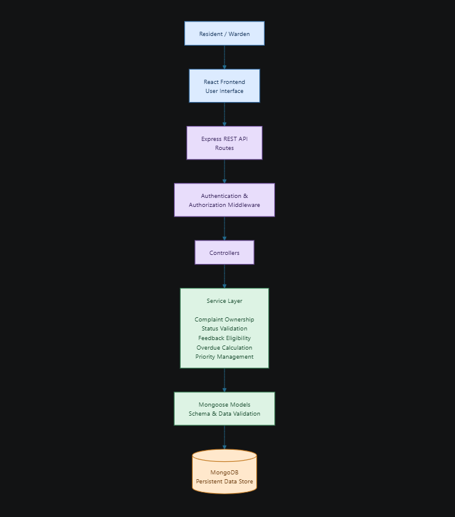
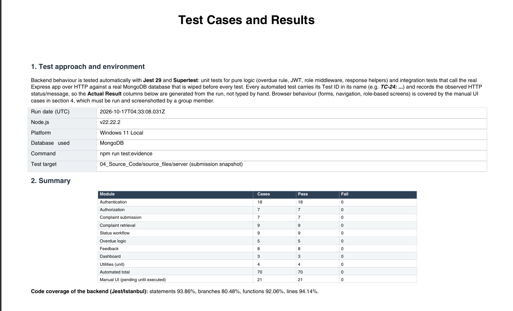
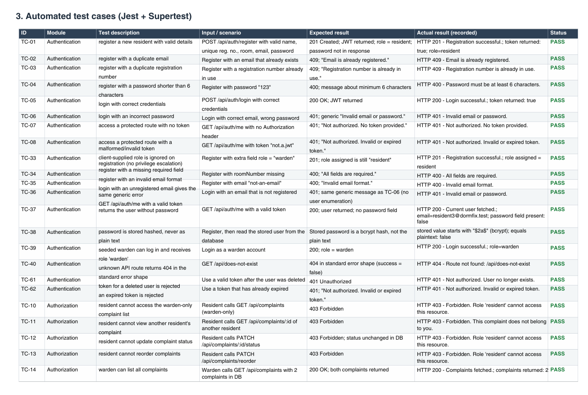
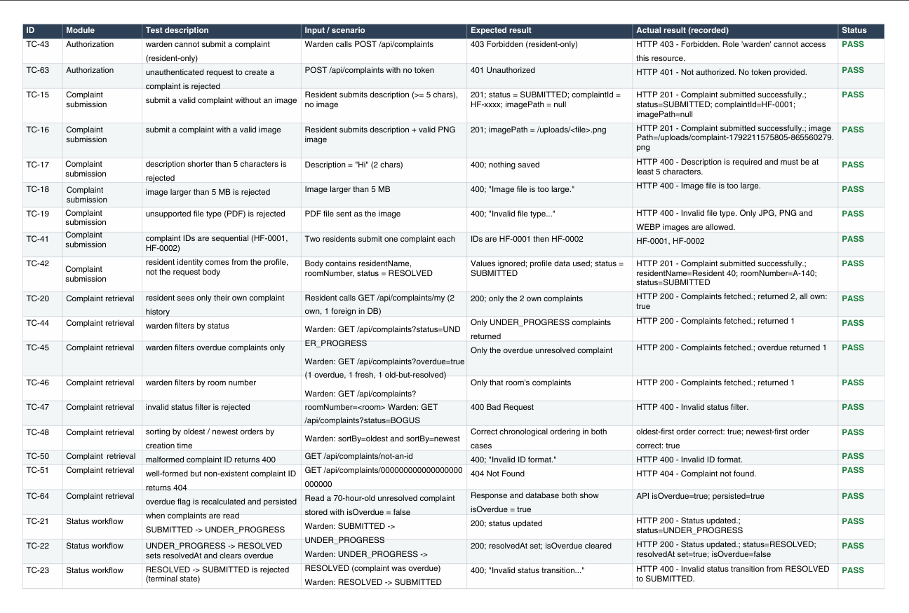
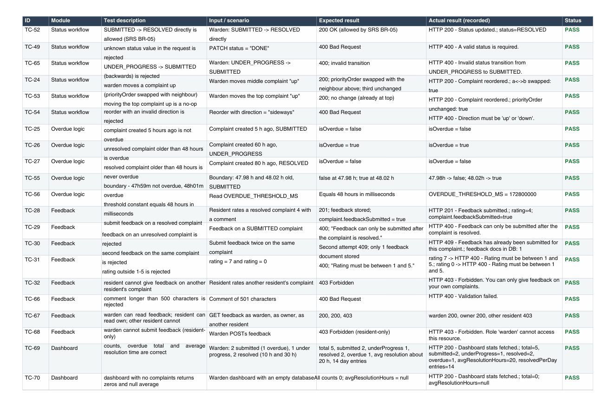
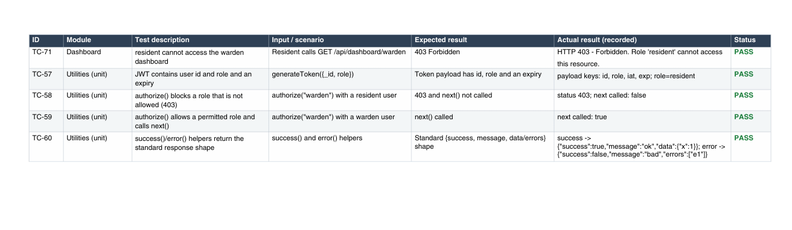
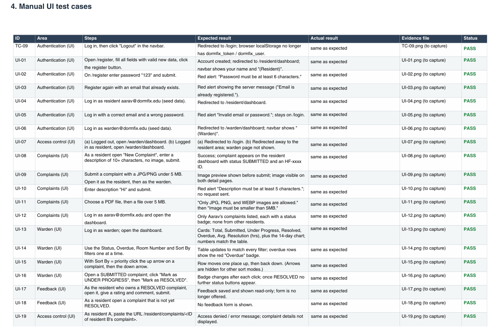
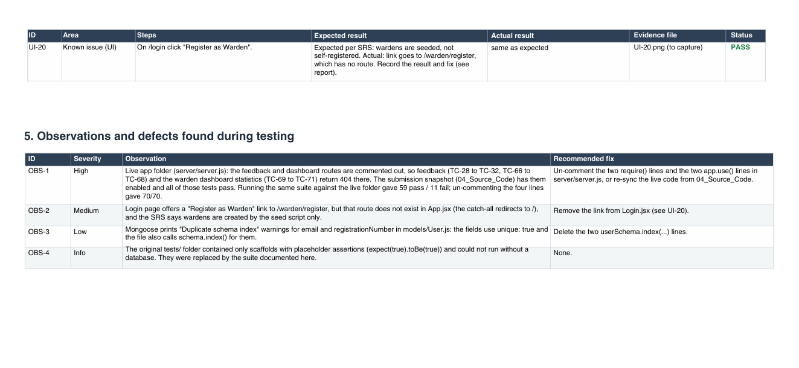

# Mid-Semester Project Report

## DormFix — Hostel Complaint & Maintenance Management System

---

### Cover Page

**Project Title:** DormFix — Hostel Complaint & Maintenance Management System

**Group Number:** 6

**Group Members:**
| Name | Registration Number |
|------|------------------------|
| Prakriti Gupta | 20243209 |
| Paramita Ghosh | 20243197 |
| Naina | 20243172 |
| Nishi Gupta | 20243187 |

**Course Name and Section:** Software Engineering and Project Management (SEPM), Section D

**Supervisor/Instructor:** Dr. Satarupa Chakrabarti

---

## 1. Problem Statement and Motivation

Hostel maintenance issues — a broken window, a leaking tap, a
flickering light — are commonly reported through informal channels:
verbal complaints to the warden, WhatsApp messages, or a notice left
at the warden's office. This approach has three recurring problems:

1. **No record of what was reported or when.** If a resident mentions
   an issue in passing, there is nothing to refer back to a week
   later if it isn't fixed.
2. **No visibility for the resident.** Once a complaint is "sent",
   the resident has no way to check whether it has been seen, is
   being worked on, or has been forgotten.
3. **No accountability or prioritization tool for the warden.** With
   many residents and a single warden, there is no structured way to
   see everything outstanding, tell what's overdue, or decide what to
   handle first.

DormFix was chosen as our project because it addresses a genuine,
observable problem with a well-bounded scope — it does not require
external integrations, has a clear two-role user model, and gives us
room to demonstrate real software-engineering practices (requirements
analysis, layered architecture, authorization enforcement, and
testing) without ballooning into an unmanageably large system.

## 2. Project Objectives

1. To provide residents with a simple and reliable mechanism for reporting hostel maintenance problems.

2. To allow residents to monitor the current status of their complaints.

3. To provide wardens with a centralized dashboard for monitoring and managing hostel complaints.

4. To maintain a structured complaint lifecycle from submission to resolution.

5. To identify complaints that have remained unresolved beyond the defined 48-hour threshold.

6. To allow the warden to manually prioritize complaints according to operational requirements.

7. To provide residents with a mechanism to submit feedback after their complaint has been resolved.

8. To enforce role-based authorization and data ownership at the server level.

9. To maintain reliable and consistent complaint data through server-side validation and controlled state transitions.

10. To provide a maintainable software architecture that can be extended with additional hostel-management capabilities in the future.

## 3. Scope of the Project

### 3.1 Features Included
- Resident registration and login; warden login (seeded account)
- Complaint submission with optional image upload
- Resident dashboard with statistics and complaint history
- Complaint details view for both roles
- Feedback system (1–5 rating + comment), restricted to resolved complaints
- Warden dashboard with aggregated statistics and a resolved-per-day chart
- Filtering (status, overdue, room) and sorting (multiple criteria)
- Manual complaint reordering by the warden
- Controlled status transitions (SUBMITTED → UNDER_PROGRESS → RESOLVED)
- Server-side overdue calculation (48-hour threshold)

### 3.2 Features Excluded (Explicitly Out of Scope)
- Technician accounts, login, or assignment workflow
- SMS, WhatsApp, or email notifications
- Push notifications or real-time updates (no WebSockets)
- Payment processing
- AI-based or automatic complaint prioritization/classification
- Mobile application (native)
- GPS or live tracking of maintenance work

### 3.3 Assumptions and Constraints
- Each resident has exactly one hostel room and one account.
- A single warden account exists for the hostel block covered by this
  version of the system.
- The system is built strictly on the MERN stack.
- Local file storage is used for uploaded images in this phase; the
  upload layer is structured so it could later be swapped for cloud
  storage (e.g. Cloudinary) without touching business logic.

## 4. Stakeholder Identification

| Stakeholder | Interest in the System |
|--------------|----------------------------|
| Residents | Need a reliable way to report issues and know their status |
| Warden | Needs visibility over all outstanding issues and a way to prioritize response |
| Hostel administration | Benefits from a documented record of maintenance activity |
| Course instructor / evaluator | Assesses the group's requirements analysis, design, and engineering practice |
| Development team (us) | Responsible for delivering a working, secure, well-documented system |

## 5. Requirements Specification

A complete requirements specification is provided in the SRS
document. In summary:

### 5.1 Functional Requirements

The functional requirements define the operations and services that DormFix shall provide to its users. Each requirement is assigned a unique identifier to support traceability across system design, implementation, and testing.

| ID | Functional Requirement |
|---|---|
| FR-01 | The system shall allow a new resident to register using the required account information. |
| FR-02 | The system shall prevent duplicate registration for an existing resident account. |
| FR-03 | The system shall authenticate registered residents and the authorized warden. |
| FR-04 | The system shall issue an authentication token upon successful login. |
| FR-05 | The system shall restrict access to protected resources to authenticated users. |
| FR-06 | The system shall enforce role-based access control for Resident and Warden operations. |
| FR-07 | The system shall allow an authenticated resident to submit a maintenance complaint. |
| FR-08 | The system shall allow a resident to attach an optional image to a complaint. |
| FR-09 | The system shall validate complaint information and uploaded image type and size. |
| FR-10 | The system shall associate each complaint with the authenticated resident who created it. |
| FR-11 | The system shall allow residents to view their complaint history. |
| FR-12 | The system shall allow authorized users to view complaint details according to their assigned roles. |
| FR-13 | The system shall maintain complaint status according to the defined lifecycle: SUBMITTED, UNDER_PROGRESS, and RESOLVED. |
| FR-14 | The system shall reject invalid complaint status transitions. |
| FR-15 | The system shall determine whether an unresolved complaint has exceeded the defined 48-hour threshold. |
| FR-16 | The system shall allow the warden to filter and sort complaints using supported criteria. |
| FR-17 | The system shall allow the warden to manually reorder complaints according to priority. |
| FR-18 | The system shall provide the warden with aggregated complaint statistics and daily resolution trends. |
| FR-19 | The system shall allow residents to submit a rating and an optional comment for resolved complaints. |
| FR-20 | The system shall prevent multiple feedback submissions for the same complaint. |
| FR-21 | The system shall persist complaint and feedback records in the database. |

### 5.2 Non-Functional Requirements

Non-functional requirements specify the quality attributes and operational constraints that DormFix must satisfy.

#### 1. Security

| ID | Requirement |
|---|---|
| NFR-01 | The system shall store passwords using secure one-way hashing and shall not store passwords in plaintext. |
| NFR-02 | The system shall require valid authentication for access to protected API endpoints. |
| NFR-03 | The system shall enforce role-based authorization on the server for all protected operations. |
| NFR-04 | The system shall prevent residents from accessing complaints belonging to other residents. |
| NFR-05 | The system shall derive resident identity from the authenticated user context rather than trusting client-provided identity information. |

#### 2. Performance

| ID | Requirement |
|---|---|
| NFR-06 | The system shall process common operations, including complaint listing and dashboard retrieval, within an acceptable response time under the expected hostel workload. |

#### 3. Usability

| ID | Requirement |
|---|---|
| NFR-07 | The system shall provide a clear and consistent user interface for complaint submission, status tracking, and complaint management. |
| NFR-08 | The system shall display understandable validation and error messages to help users correct invalid inputs and recover from failed operations. |

#### 4. Maintainability

| ID | Requirement |
|---|---|
| NFR-09 | The backend shall separate business logic from HTTP request handling and presentation logic. |
| NFR-10 | The backend shall follow a modular architecture that allows individual components to be maintained and modified independently. |

### 5.3 Prioritisation of Requirements

The requirements of DormFix are prioritised using the MoSCoW technique to distinguish essential functionality from enhancements. This helps the team allocate development effort, control project scope, and ensure that the most important user needs are addressed first.

| Priority | Requirements | Justification |
|---|---|---|
| **Must Have** | Registration and login, authentication, role-based authorization, complaint submission, complaint history, status management, complaint ownership validation, database persistence | These functions are essential for the basic operation and security of the system. |
| **Should Have** | Optional image upload, overdue calculation, complaint filtering and sorting, manual prioritisation, resident feedback | These functions improve complaint management, accountability, and usability. |
| **Could Have** | Dashboard statistics, daily resolution charts, additional interface refinements | These features improve monitoring and the overall user experience. |
| **Won't Have in This Release** | Technician assignment, notifications, native mobile application, automatic complaint classification, real-time updates | These features are outside the explicitly defined scope of the current release. |

The prioritisation is intended to guide implementation and scope management. Features in the current release are implemented according to the project requirements, while excluded features may be considered for future versions.

## 6. Requirements Model

Detailed use-case descriptions and user stories with acceptance criteria are provided in `02_Requirements/Use_Cases_and_User_Stories.md`.

The use-case documentation describes the interactions between the two primary actors of DormFix: **Resident** and **Warden**. Resident use cases cover account registration and login, submitting maintenance complaints, viewing complaint history, tracking complaint status, and providing feedback after resolution. Warden use cases cover viewing complaints submitted by residents, filtering and sorting complaints, manually adjusting complaint priority, updating complaint status, identifying overdue complaints, and monitoring dashboard statistics.

The user stories describe these functionalities from the users' perspectives and explain the purpose of each feature. Their acceptance criteria define the expected system behaviour and the conditions under which a feature can be considered successfully implemented. For example, a resident should be able to submit a complaint and track its progress but must not be able to access another resident's complaints. Similarly, a warden should be able to manage complaint status while the system rejects invalid status transitions.

Together, the use cases, user stories, and acceptance criteria establish a clear connection between user needs, functional requirements, system implementation, and testing. They help ensure that the developed system addresses the intended requirements and that its major workflows can be verified systematically.

## 7. System Design

### 7.1 Architecture
Dormfix follows a three-tier client-server architecture: a React
single-page frontend, a layered Express REST API (routes →
middleware → controllers → services → models), and a MongoDB data store. Business logic lives exclusively in the service layer, keeping controllers thin and making rules testable independent of HTTP concerns. Full diagrams are in `03_Design/Architecture_Diagram.md`.

#
The layered architecture separates presentation, request handling, business logic, and data persistence. This separation improves code organization, maintainability, and testability.

The service layer is responsible for enforcing the primary business rules of DormFix, including complaint ownership validation, permitted status transitions, feedback eligibility, overdue calculation, and manual complaint prioritization.

By keeping these rules independent of the frontend and minimizing their dependence on HTTP-specific logic, the system makes it easier to test individual operations, identify defects, and modify functionality without affecting unrelated components.

The architecture also ensures that security-sensitive operations are validated on the backend rather than relying solely on frontend restrictions.

### 7.2 Module Description
DormFix is organized into functional modules, each responsible for a specific set of operations. This modular design improves maintainability, separates responsibilities, and simplifies testing and future enhancements.

| Module | Responsibilities |
|---|---|
| **Authentication Module** | Handles resident registration, login, password hashing, JWT generation, and authentication. |
| **Authorization Module** | Enforces role-based access control and verifies complaint ownership before granting access to protected resources. |
| **Complaint Module** | Manages complaint creation, retrieval, status transitions, manual prioritization, and overdue calculation. |
| **Feedback Module** | Handles rating and comment submission for resolved complaints and prevents duplicate feedback submissions. |
| **Dashboard Module** | Aggregates and presents complaint statistics, complaint status summaries, and daily resolution trends. |
| **Upload Module** | Validates uploaded complaint images and manages their storage in the local file system. |

### 7.3 Database Design

DormFix uses MongoDB as its persistent data store, with Mongoose providing schema definition, data validation, and database interaction.Detailed description of database is documented in `03_Design/Database_Design.md`.The primary collections used in the system are described below :

#### 7.3.1 Users

The Users collection stores resident and warden account information.

Typical fields include:
- User identity
- Authentication credentials
- User role
- Hostel and room information
- Account metadata

#### 7.3.2 Complaints

The Complaints collection stores maintenance complaint information submitted by residents.

Typical fields include:
- Complaint identifier
- Resident reference
- Complaint description
- Resident information required for historical records
- Room information
- Image information
- Current complaint status
- Creation timestamp
- Resolution timestamp
- Priority order

#### 7.3.3 Feedback

The Feedback collection stores resident feedback associated with resolved complaints.

Typical fields include:
- Complaint reference
- Resident reference
- Rating
- Comment
- Feedback submission timestamp

#### 7.3.4 Counters

The Counters collection maintains sequence information required for generating sequential identifiers wherever applicable.

### 7.4 Data Integrity

DormFix enforces several application-level rules to maintain data integrity, consistency, and security:

- **Complaint Ownership:** Complaint ownership is determined using the authenticated user's identity.
- **Access Control:** Residents cannot access complaints belonging to other residents.
- **Feedback Association:** Feedback is linked to a specific resolved complaint.
- **Duplicate Feedback Prevention:** A complaint can receive feedback only once.
- **Status Validation:** Complaint status changes must follow the permitted transition rules.
- **Server-Side Overdue Calculation:** Overdue status is calculated by the server rather than being accepted from the client, ensuring consistent and reliable results. 

### 7.5 UML Diagrams
A class diagram of the backend domain model, two sequence diagrams
(complaint submission, status update), and two activity diagrams
(complaint lifecycle, authentication flow) are provided in
`03_Design/UML_Diagrams.md`.

## 8. Technology Stack and Justification

| Layer | Technology | Justification |
|-------|-------------|------------------|
| Frontend | React + Vite | Fast dev server, component-based UI suits a multi-page dashboard app, widely taught and supported |
| Routing | React Router | Standard client-side routing with role-based route guarding |
| HTTP Client | Axios | Simple interceptor support for attaching JWTs and handling 401s centrally |
| Backend | Node.js + Express | Matches the required MERN stack; minimal, well-understood REST framework |
| Database | MongoDB + Mongoose | Document model suits the complaint entity well (variable fields like optional image, resolvedAt); Mongoose adds schema validation on top of MongoDB's flexibility |
| Auth | JWT + bcryptjs | Stateless auth suited to a REST API; bcrypt is the standard for password hashing |
| File Upload | Multer | De facto standard Express middleware for multipart form handling |

## 9. Implementation Progress

### 9.1 Features Completed
- Resident registration and login with hashed passwords and JWT issuance
- Role-based middleware enforced on every protected route
- Complaint submission with optional image upload (type/size validated)
- Resident dashboard with statistics and complaint history
- Complaint details page (resident and warden views)
- Feedback submission restricted to resolved, not-yet-rated complaints
- Warden dashboard with aggregated statistics and a resolved-per-day chart
- Filtering and sorting of the complaint list
- Manual up/down reordering of complaint priority
- Controlled status transition rules enforced server-side
- Server-calculated overdue flag (48-hour threshold), recalculated on
  every relevant read rather than trusted from the client
- Seed script for reproducible demo data

### 9.2 Features Under Development
- Handling of additional interface edge cases
- Final accessibility and responsiveness review

### 9.3 Screenshots of the Working System

#### 9.3.1 Resident Login Page

The login page allows registered residents to authenticate and access the DormFix system.

*Figure 2: Resident login page.*

#### 9.3.2 Resident Dashboard

The resident dashboard provides an overview of submitted complaints and their current statuses.

*Figure 3: Resident dashboard.*

#### 9.3.3 New Complaint Form

The complaint submission form enables residents to report hostel maintenance issues and attach an image when required.

*Figure 4: New complaint submission form.*

#### 9.3.4 Complaint Details

The complaint details page displays the information associated with a selected complaint, including its status and any attached image.

*Figure 5: Complaint details with image attachment.*

#### 9.3.5 Warden Dashboard

The warden dashboard presents complaint statistics and daily resolution trends to support maintenance monitoring.

*Figure 6: Warden dashboard showing statistics and resolution trends.*

#### 9.3.6 Warden Complaint List

The complaint management interface allows the warden to filter and sort complaints and review their current statuses.

*Figure 7: Warden complaint list with filters applied.*

#### 9.3.7 Feedback Form

The feedback form allows residents to submit a rating and an optional comment after a complaint has been resolved.

*Figure 8: Resident feedback form.*

### 9.4 Important Implementation Decisions
- **Resident identity fields are read from the authenticated user's
  profile server-side**, not trusted from the request body, when a
  complaint is created — this closes an obvious spoofing vector where
  a malicious client could submit a complaint under someone else's name.
- **The overdue flag is never trusted from the client** and is
  recalculated from the server clock on every read that matters
  (dashboard, complaint list, complaint details).
- **Status transitions are validated against a fixed rule table** on
  the server (e.g. `RESOLVED` cannot go back to `SUBMITTED`), so the
  frontend cannot force an invalid state even if compromised.
- **Manual reordering was chosen over automatic prioritization**
  specifically because the project brief calls for warden judgment,
  not algorithmic urgency scoring — this was a deliberate scope
  decision, not a missing feature.

## 10. Testing Performed

Testing is being performed at multiple levels to verify both functional correctness and security-related behavior.

### 10.1 Authentication Testing

Tests include:

- Valid login
- Invalid credentials
- Duplicate registration
- Protected endpoint access without authentication

### 10.2 Authorization Testing

Tests include:

- Resident accessing resident-only functionality
- Resident attempting to access warden-only endpoints
- Resident attempting to access another resident's complaint
- Invalid or manipulated complaint identifiers

### 10.3 Complaint Testing

Tests include:

- Valid complaint creation
- Missing or invalid complaint information
- Description length validation
- Image type validation
- Image size validation
- Complaint retrieval
- Status transition validation

### 10.4 Overdue Logic Testing

The overdue mechanism is tested around the defined threshold, including complaints:

- Below 48 hours
- At approximately 48 hours
- Beyond 48 hours
- Already resolved complaints

### 10.5 Feedback Testing

Tests include:

- Feedback for resolved complaints
- Feedback for unresolved complaints
- Duplicate feedback submission
- Unauthorized feedback access

A structured test case table (32 test cases across authentication,
authorization, complaint management, overdue logic, and feedback) is
provided in `05_Testing/Test_Cases.md`, with expected results defined
for each case. Actual results and pass/fail status, along with
supporting screenshots, are being finalized ahead of submission and
stored in `05_Testing/Test_Evidence/`.

## 11. Project-Management Status

### 11.1 Original Project Plan

Development followed an incremental approach in which requirements and system design were established before the implementation of individual modules. This approach supported modular development, progressive verification, and integration of the system's components.

The project was organized into the following major phases:

1. Requirements Analysis
2. System Design
3. Authentication and Authorization
4. Complaint Management
5. Warden Management
6. Feedback and Dashboard
7. Testing and Verification
8. Documentation and Demonstration

The original project plan defined the expected deliverables, task allocation, timeline, risks, and mitigation strategies for each phase. Refer to `06_Project_Management/Project_Plan.md` for the complete project timeline and progress summary.

### 11.2 Final Project Progress

All planned project phases have been completed. The delivered system covers requirements analysis, system design, authentication, authorization, complaint management, warden functionality, feedback, testing, documentation, and demonstration preparation.

The final project deliverables include:

- Requirements and design documentation, including the SRS, use cases, architecture, database design, and UML diagrams.
- Authentication and authorization mechanisms, including password hashing, JWT-based authentication, protected resources, and role-based access control.
- Complaint submission, optional image attachments, complaint history, status tracking, and ownership validation.
- Warden dashboard functionality, including complaint filtering, sorting, manual prioritization, status management, and dashboard statistics.
- Feedback functionality for resolved complaints, including ratings and optional comments.
- Testing and verification of implemented workflows, along with supporting test documentation.
- Project report, project management records, contribution details, Git evidence, screenshots, and demonstration materials.

The project has completed its planned scope. The final status is recorded as **100% of planned project phases completed**. This refers to completion of the planned phases and deliverables, rather than a claim that the system is free from every possible defect or limitation.

### 11.3 Delayed or Pending Tasks

At the time of this report, no outstanding tasks have been reported against the original project plan. The planned implementation, testing, documentation, and demonstration-preparation activities have been completed.

| Task | Final Status |
|---|---|
| Requirements and design documentation | Completed |
| Authentication and authorization | Completed |
| Complaint management and image upload | Completed |
| Warden dashboard and complaint management | Completed |
| Feedback functionality | Completed |
| Testing and verification | Completed |
| UI refinement and error handling | Completed |
| Final report and project documentation | Completed |
| Demonstration preparation and submission packaging | Completed |

### 11.4 Risks and Mitigation Plan

The project team identified risks that could affect development, integration, testing, and demonstration. Mitigation measures were incorporated into the development and review process.

| Risk | Potential Impact | Mitigation |
|---|---|---|
| Limited development time near the submission deadline | Incomplete testing or documentation | Distributed responsibilities and incremental development helped the team complete the planned deliverables. |
| Database or environment failure during demonstration | Temporary unavailability of the system | Database configuration and application setup instructions were reviewed to support reproducible execution. |
| Defects in authentication, authorization, or complaint workflows | Unauthorized access or incorrect system behaviour | Authentication checks, role-based authorization, ownership validation, and complaint lifecycle rules were implemented and tested. |
| Scope expansion | Delays in core functionality | The documented project scope was maintained, and out-of-scope features were excluded from the current implementation. |
| Integration issues between frontend and backend components | Inconsistent behaviour or failed requests | Modular architecture, API integration, and workflow verification were used to support integration. |
| Uneven task distribution or delays in dependent modules | Reduced development efficiency | Responsibilities were assigned by functional area, with progress documented through project records and repository activity. |

The complete risk register and mitigation plan are documented in `06_Project_Management/Project_Plan.md`, Section 3. 

## 12. Individual Contribution Table

A detailed breakdown of task-level ownership and individual responsibilities, along with the signed declaration of all team members, is provided in `06_Project_Management/Contribution_Record.md`.

The summary of individual contributions is presented below.

| Member Name | Primary Responsibility | Contribution % |
|---|---|---:|
| Prakriti Gupta | Backend authentication, complaint backend implementation, SRS preparation, and demo video preparation | 32% |
| Paramita Ghosh | Authorization, resident complaint interface, warden interface, project report, and project management documentation | 28% |
| Naina | Feedback functionality, test case preparation, software testing, and testing documentation | 30% |
| Nishi Gupta | UML diagrams and system design documentation | 10% |
| **Total** | | **100%** |

## 13. Challenges Faced and Solutions Attempted

| Challenge | Solution Attempted |
|-----------|------------------------|
| Deciding how to calculate "overdue" reliably without trusting the frontend | Moved the calculation entirely server-side, recalculated on every relevant read, using the server clock against `createdAt` |
| Preventing residents from accessing each other's complaints via direct ID requests | Added an explicit ownership check in the service layer for every complaint/feedback read, independent of what the frontend shows |
| Keeping manual reordering meaningful without letting it become de facto automatic prioritization | Implemented reordering as a simple neighbor-swap on an explicit `priorityOrder` field, only ever changed by an explicit warden action |
| Avoiding scope creep toward features like notifications | Reaffirmed scope boundaries early via the SRS MoSCoW prioritization and referred back to it during sprint planning (see Meeting Log) |

## 14. Future Scope

The current architecture provides a foundation for extending DormFix beyond the current release.

Possible future enhancements include:

- Dedicated maintenance technician accounts
- Technician assignment and work tracking
- Email or SMS notifications
- Push notifications
- Real-time complaint updates
- Mobile application
- Maintenance analytics
- Automatic complaint categorization
- Automated priority recommendations
- Hostel-wide maintenance reports
- Integration with institutional authentication systems
- Cloud-based image storage
- Multi-hostel and multi-block support

These features are outside the scope of the current release and would require corresponding changes to the requirements, architecture, security model, and testing strategy.

## 15. Conclusion

DormFix provides a structured digital workflow for managing hostel maintenance complaints.

The system replaces fragmented complaint reporting with a centralized platform through which residents can submit and monitor complaints while wardens can manage, prioritize, and track maintenance activity.

The implementation emphasizes several important software-engineering principles:

- Requirement-driven development
- Separation of concerns
- Layered architecture
- Role-based access control
- Server-side validation
- Data ownership enforcement
- Controlled state transitions
- Persistent data management
- Structured testing
- Explicit scope management

The current implementation establishes the core complaint-management workflow and provides a foundation for future extensions such as technician management, notifications, real-time updates, and multi-hostel support.

## 16. References

1. Express.js Documentation — https://expressjs.com/
2. Mongoose Documentation — https://mongoosejs.com/docs/
3. React Documentation — https://react.dev/
4. Vite Documentation — https://vitejs.dev/
5. JSON Web Tokens Introduction — https://jwt.io/introduction
6. MDN Web Docs, "Using the Fetch API" / REST concepts — https://developer.mozilla.org/

---

