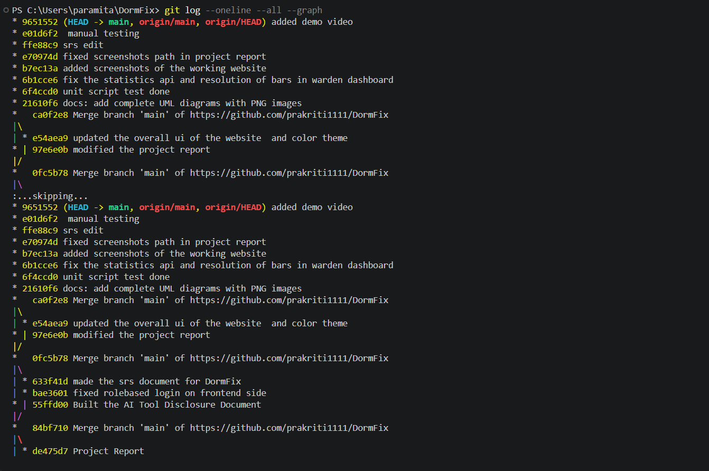

# Contribution Record
## Dormfix — Hostel Complaint & Maintenance Management System

## 1. Individual Contribution Table

## 1. Individual Contribution Table

| Member Name | Registration Number | Primary Responsibilities | Key Deliverables | Approx. Contribution % |
|---|---|---|---|---:|
| Prakriti Gupta | 20243209 | Backend authentication, complaint backend, requirements documentation, and demo video preparation | Authentication and login functionality, complaint backend implementation, Software Requirements Specification (SRS), and mid-semester demo video | 32% |
| Paramita Ghosh | 20243197 | Authorization, complaint and warden interface development, project report, and project management documentation | Role-based authorization, complaint UI, warden UI, mid-semester project report, and project management documentation | 28% |
| Naina | 20243172 | Software testing and feedback-related work | Test case preparation and execution, feedback functionality, and testing-related documentation and evidence | 30% |
| Nishi Gupta | 20243187 | UML modelling and system design documentation | UML diagrams representing the system's structure and behaviour | 10% |
| **Total** | — | — | — | **100%** |


## 2. Task-Level Breakdown

| Task | Owner | Status |
|---|---|---|
| Problem statement and scope definition | All members | Complete |
| SRS document | Prakriti Gupta | Complete |
| Use cases and user stories | Naina | Complete |
| Architecture diagram | Naina, Prakriti Gupta | Complete |
| Database design | Paramita Ghosh | Complete |
| UML diagrams | Nishi Gupta | Complete |
| Backend: authentication module | Prakriti Gupta | Complete |
| Backend: authorization and role-based access control | Paramita Ghosh | Complete |
| Backend: complaint module | Naina | Complete |
| Backend: feedback module | Naina | Complete |
| Backend: dashboard and statistics module | Prakriti Gupta | Complete |
| Frontend: authentication pages and context | Prakriti Gupta | Complete |
| Frontend: resident complaint interface | Paramita Ghosh | Complete |
| Frontend: warden interface | Naina, Paramita Ghosh | Complete |
| Seed script | Verify actual contributor | Verify implementation status |
| Test case design | Naina | Complete |
| Test execution and evidence collection | Naina | Complete |
| Mid-semester report compilation | Paramita Ghosh | Complete |
| Project management documentation | Paramita Ghosh | Complete |
| Demo video preparation and recording | Prakriti Gupta | Complete |


## 3. Git Commit Evidence

The output of:

```bash
git log --oneline --all --graph
```




